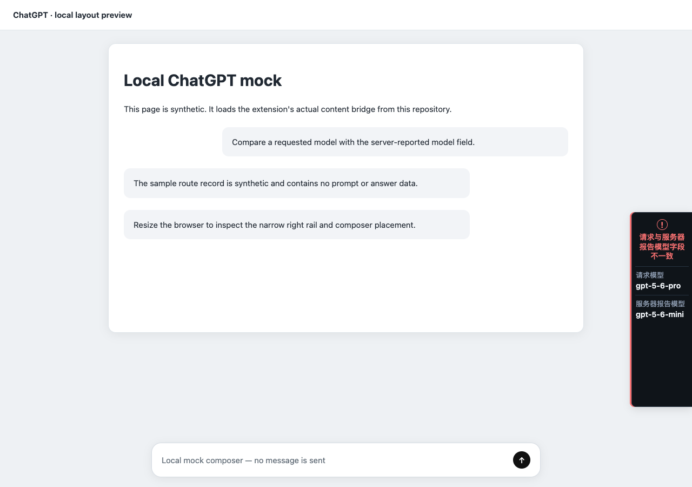
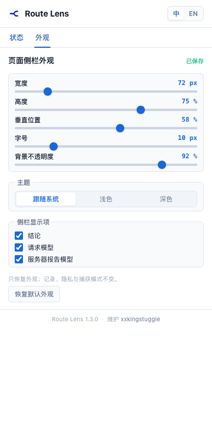

<p align="center">
  
</p>

<h1 align="center">Route Lens</h1>

<p align="center">对照 ChatGPT Web 请求模型与 SSE 响应流模型字段的 Chrome Manifest V3 扩展。</p>

<p align="center">
  <a href="https://github.com/xxkingstuggle/route-lens/releases/latest"></a>
  
</p>

<p align="center">
  <a href="https://github.com/xxkingstuggle/route-lens/releases/latest">下载 Release</a> ·
  <a href="https://myzjx.com/software/route-lens/">项目概览</a> ·
  <a href="https://myzjx.com/posts/route-lens-chatgpt-routing-inspector/">工程手记</a> ·
  <a href="docs/frontend.md">前端与预览说明</a> ·
  <a href="MAINTENANCE.md">维护约定</a>
</p>

## 解决什么问题

在 ChatGPT Web 端切换模型时，前端发起的请求模型参数与服务端 SSE 响应流实际返回的模型标识未必始终一致。Route Lens（当前版本 **1.3.1**）在页面上下文只读提取请求与响应中的路由字段，通过 Shadow DOM 右侧窄栏与工具栏 Popup 实时展示对照结果。

| 能力 | 行为与边界 |
|---|---|
| 请求与响应字段对照 | 提取页面请求中的目标模型字段与服务器响应流报告的模型字段，自动标记一致、不一致或信息不足 |
| 证据边界透明 | 只展示页面可观察到的字段值；**字段一致或不一致不代表已证明底层执行模型、回答质量或“降智”**，缺少字段时明确显示无法确认，PoW 仅作为原始技术元数据保留 |
| Shadow DOM 右侧窄栏 | 由 `extension/content/bridge.js` 在隔离样式作用域内渲染，支持长模型名滚动，并在窄视口（≤1120 px）自动适配页面右侧留白 |
| Popup 状态与外观调节 | 工具栏弹窗包含「状态」与「外观」双页签，可即时调节窄栏宽度（64–112 px）、高度、垂直位置、字号、不透明度、深浅色主题与字段显示开关；「恢复默认」仅重置外观项，不清除历史记录 |

## 界面预览

以下预览由 `node scripts/ui-preview.mjs` 在无头 Chromium 中加载真实 `extension/content/bridge.js` 与 Popup 页面生成（详见 [前端说明](docs/frontend.md)）：

**右侧窄栏（深色主题）**



**工具栏 Popup（状态与外观设置）**



## 安装使用

### 方式一：从 GitHub Releases 安装

1. 前往 [Releases (v1.3.1)](https://github.com/xxkingstuggle/route-lens/releases/tag/v1.3.1) 下载 `route-lens-1.3.1.zip`（可对照 `SHA256SUMS.txt` 校验）。
2. 解压到本地固定目录（例如 `~/Library/Application Support/Google/Chrome/Local Extensions/Route Lens`）。
3. 在 Chrome 打开 `chrome://extensions/`，开启右上角「开发者模式」，点击「加载已解压的扩展程序」并选择解压后的目录（目录根部包含 `manifest.json`）。

### 方式二：直接从仓库源码加载

克隆本仓库后，在 `chrome://extensions/` 中点击「加载已解压的扩展程序」，直接指向仓库内的 `extension/` 目录即可。

## 本地检查与打包

```sh
# 运行核心逻辑与边界单元测试
npm test

# 检查脚本语法与扩展结构
npm run check

# 在无头 Chrome/Chromium 中生成 Popup 与窄栏预览截图
node scripts/ui-preview.mjs

# 打包可加载的扩展归档至 dist/
npm run package

# 导出候选发布目录（含扩展 ZIP、源码 ZIP 与校验文件）至 outputs/route-lens-1.3.1/
node scripts/export-candidate.mjs
```

- `ui-preview` 默认输出到 `outputs/route-lens-1.3.1/previews/`，可通过 `CHROME_PATH` 指定浏览器可执行文件，或通过 `--out-dir` / `ROUTE_LENS_PREVIEW_DIR` 指定截图输出目录。
- `export-candidate.mjs` 默认不覆盖已有候选导出；明确需要替换时传入 `--replace`。

## 维护者

`xxkingstuggle`
